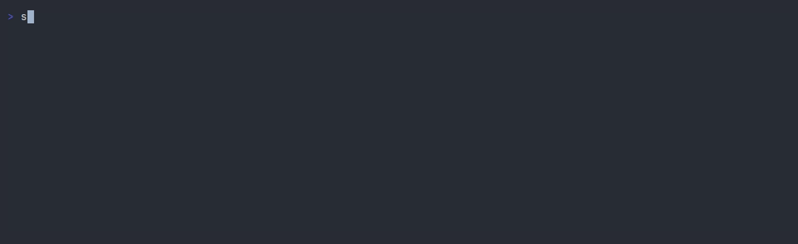

# sidels

シェルの横に今いるディレクトリのファイル一覧を出しておく小さなツールです。



打っている途中のコマンドにも少し反応します（`cd src/` で移動先を先に見せる、`rm *.log` で消えるファイルを光らせる、など）。
Git の管理下では変更のあるファイルに `M` や `?` の印が付き、消したファイルも取り消し線で出ます。また、見出しには今のブランチが出て、push していないコミットがあれば `main ↑2` のように数も付きます。
5 分以内に書き換えられたファイルには `●` が付きます。Claude Code などのプログラムを動かしている間は、そのプログラムを起動してから変わったファイルにも、コミットしたあとも含めて `●` が付き続けるので、何を触ったかが分かります。
Git が無視しているもの（`node_modules/` など）は薄く表示します（Git の外では、`.` で始まるものを薄くします）。

パネルが追いかけるのはそのとき前面で動いているプログラムの今いる場所です。シェルから起動した Claude Code が worktree に移ると、パネルも付いていきます。

中で動くのはいつものシェル（`$SHELL`）なので、設定やキー操作はそのまま使えます。

> Linux（WSL 含む）と macOS で動きます。x86_64 と ARM（Apple Silicon を含む）に対応しています。
> macOS はまだあまり試せていません。

## インストール

ビルド済みのファイルをダウンロードして `~/.local/bin` に置きます（`uname` で OS と PC の種類に合ったファイルを選びます）。

```sh
mkdir -p ~/.local/bin
curl -L https://github.com/harumaki1220/sidels/releases/latest/download/sidels-$(uname -m)-$(uname -s | tr A-Z a-z).tar.gz | tar xz -C ~/.local/bin
```

`sidels` と打って `command not found` になるときは、`~/.local/bin` がパスに入っていません。
次の 1 行を足して、ターミナルを開き直してください（bash なら `~/.zshrc` を `~/.bashrc` に）。

```sh
printf '\nexport PATH="$HOME/.local/bin:$PATH"\n' >> ~/.zshrc
```

Rust（1.88 以上）があれば、ソースからビルドすることもできます（C のリンカーも必要です。Ubuntu なら `sudo apt install build-essential`）。

```sh
cargo install --locked --git https://github.com/harumaki1220/sidels
```

`sidels` で起動し、`exit` でシェルを終えると一緒に終了します。
Nerd Font を使っているなら、`sidels --icons` で起動するとファイルの種類ごとのアイコンが付きます（持っていないと文字化けするので、最初はオフです）。

### zsh との連携（任意）

zsh を使っているなら、`.zshrc` に次の 1 行を足すと、打ちかけのコマンドを zsh から直接受け取るようになります。
足さなくても使えますが、zsh-autosuggestions の灰色の候補にパネルが反応しなくなるなど、より正確になります。
sidels の外で開いた zsh では何もしないので、書いたままで大丈夫です（zsh 5.3 以上）。

```zsh
eval "$(sidels init zsh)"
```

## 操作

| 操作 | 動き |
|---|---|
| F12 | パネルの出し入れ（狭いウィンドウでは自動で隠れる。Mac では fn+F12） |
| ホイール / Shift+↑↓ / Shift+PgUp・PgDn | 過去の出力をスクロール（パネルの上のホイールは、入りきらない一覧をスクロール） |
| ドラッグ → Ctrl+C | シェル側だけを選択してコピー（上下の端までドラッグするか、押したままホイールを回すと、画面の外まで選べる。選択していないときの Ctrl+C は、いつもどおり中断） |
| ダブルクリック / トリプルクリック | 単語 / 行を選択（パスは丸ごと選べる） |

## 普通のターミナルとの違い

sidels は、ターミナルの中にもう 1 つ小さなターミナルを作り、その中でシェルを動かしています。
シェルの画面は sidels が描き直して左側に出しているので、普段ターミナルがやっていることの一部を sidels が代わりにやっています。
そのため、普通のターミナルと少し違うところがあります。

- スクロール、文字の選択、コピーは sidels が行います。ターミナルの設定（スクロールの速さ、選択の区切り方など）は効きません
- マウス操作を受け取るので、Windows Terminal の右クリック貼り付けは効きません（Ctrl+V は使えます）
- コピーは、ターミナルの OSC 52 という仕組みでクリップボードに入れます（Windows Terminal、iTerm2、Ghostty などは対応しています）。macOS 標準の Terminal.app は非対応なので、代わりに `pbcopy` を使います
- 中のアプリ（vim や Claude Code など）が出したコピー、ウィンドウのタイトル、今いる場所の知らせ（OSC 7）は、外側のターミナルにそのまま伝えます
- zsh との連携を設定していないときは、入力中の内容を画面から読み取るので、zsh-autosuggestions の灰色の候補にも反応することがあります
- 中のシェルには `SIDELS=1` が渡ります。`.zshrc` から sidels を自動で起動するときに、入れ子にならないようにするのに使えます

## ライセンス

[MIT](LICENSE)
